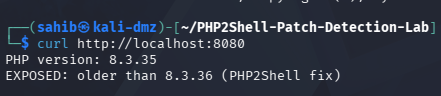
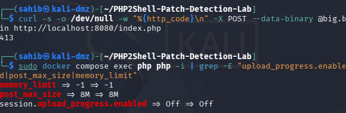
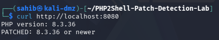

# PHP2Shell Patch & Detection Lab (CVE-2026-109618, CVE-2026-109619)

PHP2Shell is a pair of critical remote code execution bugs in PHP itself, patched on Oct 21, 2026 in PHP 8.2.35, 8.3.36, 8.4.27 and 8.5.12. This lab walks the defensive side: confirm exposure, add stopgaps, patch, verify, and detect.

No exploit code is used. Everything runs in Docker on localhost.

## Setup

- `php` container: php-fpm 8.3, tag set in `.env`
- `nginx` container: front end on http://localhost:8080, logs to `./logs`
- `splunk` container (optional profile): reads `./logs`

## Steps

1. **Confirm exposure.** Start on an unpatched 8.3 tag. `docker compose exec php php -v` and http://localhost:8080 both show a version below 8.3.36.
2. **Generate test events.** A 20 MB POST and a page that runs out of memory. Neither is the exploit. They just leave the same two log signals.
3. **Detect.** Splunk search over the nginx logs for oversized POSTs and PHP out-of-memory errors.
4. **Stopgaps.** nginx `client_max_body_size 8m`, plus PHP `session.upload_progress.enabled=0`, `post_max_size=8M`, `memory_limit=-1` with a container memory cap. These are partial and come from the PHP advisory.
5. **Patch.** Change the tag to 8.3.36 and recreate the container.
6. **Verify.** Version check shows 8.3.36 and "PATCHED".

## Splunk search

```
index=main source="/logs/*" ((method=POST (req_len>1000000 OR status=413)) OR "Allowed memory size")
| eval signal=if(searchmatch("Allowed memory size"), "php_out_of_memory", "oversized_post")
| stats count by signal
Status: the search is written and the two log signals were checked by hand in the lab. It has not been run in Splunk against this lab yet.
```

## Screenshots







## Limits

- The stopgaps block the known attack paths only. Patching is the fix.
- The detection is a starting point. Big uploads and memory errors also happen for normal reasons, so it needs tuning per site.
